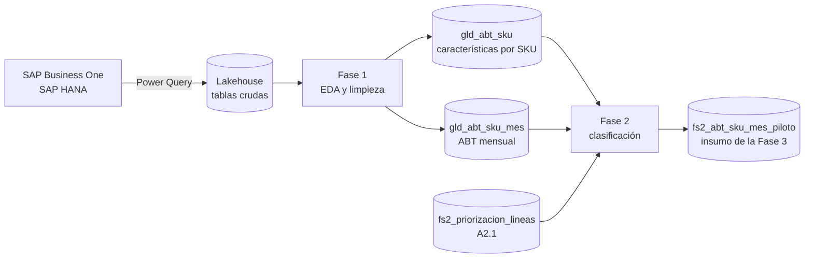

# Enfoque híbrido de clasificación y predicción de demanda de productos

Código del trabajo integrador de la **Maestría en Analítica e Inteligencia de Negocios** (Universidad del Valle). El proyecto propone un enfoque híbrido para una empresa distribuidora de suplementos vitamínicos: primero clasifica el portafolio combinando la **importancia** de cada producto con la **dificultad de pronosticar** su demanda, y luego concentra el modelo de predicción en el grupo de productos donde un mejor pronóstico aporta más valor.

El trabajo sigue la metodología **CRISP-DM** y se desarrolla en notebooks de PySpark sobre Microsoft Fabric, con datos transaccionales extraídos de SAP Business One (SAP HANA).

> **Confidencialidad.** El repositorio no contiene datos, salidas ni información de la empresa. Los nombres de servidor, base de datos, archivos internos, bodegas y patrones de codificación se reemplazaron por parámetros genéricos, y las celdas de interpretación explican cómo leer cada resultado sin cifras del negocio.

## Contenido

```
Tesis-Maestria/
├── notebooks/
│   ├── 01_fase1_comprension_preparacion_datos.ipynb   # Fase 1: EDA, limpieza y tablas base analíticas
│   └── 02_fase2_clasificacion_productos.ipynb         # Fase 2: clasificación multicriterio y grupo piloto
├── .gitignore                                         # excluye datos, documentos y credenciales
├── requirements.txt
└── README.md
```

| Notebook | Actividades | Qué hace |
|---|---|---|
| `01_fase1_comprension_preparacion_datos` | A1.1 – A1.3 | Homologa códigos de producto, fija la ventana de análisis, caracteriza la demanda (Pareto/ABC, Syntetos-Boylan, XYZ, clientes, inventario, devoluciones, promociones), aplica seis reglas de calidad con trazabilidad y construye las tablas base analíticas. |
| `02_fase2_clasificacion_productos` | A2.2 – A2.4, A4.1 | Clasifica los productos en dos ejes (prioridad y pronosticabilidad) con varias familias de métodos, mide su concordancia y estabilidad, selecciona el grupo piloto por consenso y lo valida con un backtest. Se ejecuta sobre la línea priorizada y sobre el universo total. |

## Flujo de datos



## Metodología en breve

**Fase 1 — Comprensión y preparación de los datos**

- Extracción de pedidos, facturas, devoluciones, maestro de productos y cierre diario de inventario (reconstruido desde los movimientos con funciones de ventana).
- Snapshot fijo de las tablas Delta (`VERSION AS OF`) para que las cifras sean reproducibles.
- Homologación de códigos de producto reemplazados, validada con las fechas de pedido.
- Ventana de análisis con meses completos y delimitación del universo por ciclo de vida.
- Perfil de demanda por SKU: ADI y CV² (Syntetos, Boylan y Croston, 2005), CV de 12 meses, concentración de clientes (HHI), quiebres de stock, vencimientos, devoluciones, descuento incremental y alzas de precio.
- Reglas de calidad R1–R6 con reporte de filas, unidades y valor excluidos por regla; marcación de atípicos con z robusto (Iglewicz y Hoaglin, 1993).
- Salidas: `gld_abt_sku_mes` (una fila por SKU y mes) y `gld_abt_sku` (una fila por SKU, ocho dimensiones), con diccionario de datos.

**Fase 2 — Clasificación de los productos**

- Eje de **prioridad** (valor, crecimiento y costo del error en inventario) y eje de **pronosticabilidad** (regularidad, intermitencia e historia).
- Métodos multicriterio: TOPSIS, VIKOR y PROMETHEE II, con pesos iguales, entropía y CRITIC.
- Clustering: K-means, Ward y GMM, con selección de k por índices internos.
- Reglas de referencia: ABC·SB y ABC·XYZ.
- Consenso por votos, concordancia (W de Kendall, ARI, NMI), estabilidad (pesos aleatorios de Dirichlet y submuestreo del 80 %), emulador explicativo con árbol de decisión y validación externa con backtest de origen móvil (MASE, WMAPE).

## Cómo ejecutar

Los notebooks están pensados para **Microsoft Fabric** con un Lakehouse asociado, donde `spark` y `display` los provee el entorno.

1. Cargar en el Lakehouse las tablas de origen: `Pedidos`, `Ventas`, `Devoluciones`, `Inventario` y `Productos` (consultas en la sección 1.1 de la Fase 1), más el archivo de equivalencias de códigos.
2. En la celda **Parámetros específicos del entorno** de la Fase 1, reemplazar los valores de ejemplo (ruta del archivo de equivalencias, bodegas, patrones de muestras y líneas excluidas).
3. Ajustar `VERSIONES` (sección 1.1) con las versiones Delta del snapshot y ejecutar la Fase 1.
4. Ejecutar la priorización de líneas (A2.1), que genera `fs2_priorizacion_lineas`, y luego la Fase 2.

Para ejecutarlos fuera de Fabric se necesita una sesión de Spark con soporte Delta y una función `display` (por ejemplo, `from IPython.display import display`).

## Autor

**Daniel Escobar Cardona** — Maestría en Analítica e Inteligencia de Negocios, Universidad del Valle.
Director: PhD. Robinson Andrey Duque Agudelo.
