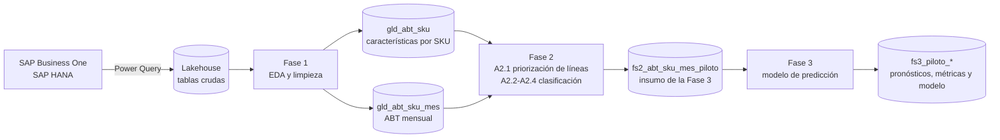

# Enfoque híbrido de clasificación y predicción de demanda de productos

Código del trabajo integrador de la **Maestría en Analítica e Inteligencia de Negocios** (Universidad del Valle). El proyecto propone un enfoque híbrido para una empresa distribuidora de suplementos vitamínicos: primero clasifica el portafolio combinando la **importancia** de cada producto con la **dificultad de pronosticar** su demanda, y luego concentra el modelo de predicción en el grupo de productos donde un mejor pronóstico aporta más valor.

El trabajo sigue la metodología **CRISP-DM** y se desarrolla en **tres notebooks de PySpark, uno por fase**, sobre Microsoft Fabric, con datos transaccionales extraídos de SAP Business One (SAP HANA). La evaluación (Fase 4 del proyecto) no tiene notebook propio: se hace dentro del notebook de cada modelo (A4.1 en la Fase 2 y A4.2 en la Fase 3).

> **Confidencialidad.** El repositorio no contiene datos, salidas ni información de la empresa. Los nombres de servidor, base de datos, archivos internos, bodegas y patrones de codificación se reemplazaron por parámetros genéricos, y las celdas de interpretación explican cómo leer cada resultado sin cifras del negocio.

## Contenido

```
Tesis-Maestria/
├── notebooks/
│   ├── 01_fase1_comprension_preparacion_datos.ipynb   # Fase 1: EDA, limpieza y tablas base analíticas
│   ├── 02_fase2_clasificacion_productos.ipynb         # Fase 2: priorización de líneas, clasificación y grupo piloto
│   └── 03_fase3_pronostico_piloto.ipynb               # Fase 3: modelo de predicción de los productos piloto
├── .gitignore                                         # excluye datos, documentos y credenciales
├── requirements.txt
└── README.md
```

| Notebook | Actividades | Qué hace |
|---|---|---|
| `01_fase1_comprension_preparacion_datos` | A1.1 – A1.3 | Homologa códigos de producto, fija la ventana de análisis, caracteriza la demanda (Pareto/ABC, Syntetos-Boylan, XYZ, clientes, inventario, devoluciones, promociones), aplica seis reglas de calidad con trazabilidad y construye las tablas base analíticas. |
| `02_fase2_clasificacion_productos` | A2.1 – A2.4, A4.1 | Un solo notebook en dos partes. Primero (A2.1) compara las líneas comerciales en tres dimensiones (importancia, dificultad de pronóstico y costo del error de inventario) con TOPSIS y 10.000 simulaciones de pesos de Dirichlet, prioriza una línea y guarda `fs2_priorizacion_lineas`. Luego (A2.2 a A2.4 y A4.1), en el mismo notebook, clasifica los productos en dos ejes (prioridad y pronosticabilidad) con varias familias de métodos, mide su concordancia y estabilidad, selecciona el grupo piloto por consenso y lo valida con un backtest. Se ejecuta sobre la línea priorizada y sobre el universo total. |
| `03_fase3_pronostico_piloto` | A3.1 – A3.4, A4.2 | Analiza las series y los picos de los productos piloto, compara diez métodos (simples, ETS, SARIMA, XGBoost, Random Forest, LSTM e híbrido ARIMA-CNN-LSTM) con validación de origen móvil, ajusta Random Forest y sus variantes, prueba la significancia con Wilcoxon, guarda el modelo propuesto y genera los pronósticos de los tres meses siguientes. |

## Flujo de datos



## Metodología en breve

**Fase 1 — Comprensión y preparación de los datos**

- Extracción de pedidos, facturas, devoluciones, maestro de productos y cierre diario de inventario (reconstruido desde los movimientos con funciones de ventana).
- Snapshot fijo de las tablas Delta (`VERSION AS OF`) para que las cifras sean reproducibles.
- Homologación de códigos de producto reemplazados, validada con las fechas de pedido.
- Ventana de análisis con meses completos y delimitación del universo por ciclo de vida.
- Perfil de demanda por SKU: ADI y CV² (Syntetos, Boylan y Croston, 2005), CV de 12 meses, concentración de clientes (HHI), quiebres de stock, vencimientos, devoluciones, descuento incremental y alzas de precio.
- Reglas de calidad R1–R6 con reporte de filas, unidades y valor excluidos por regla; marcación de atípicos con z robusto (Iglewicz y Hoaglin, 1993).
- Salidas: `gld_abt_sku_mes` (una fila por SKU y mes) y `gld_abt_sku` (una fila por SKU, ocho dimensiones), con diccionario de datos.

**Fase 2 — Clasificación de los productos**

- Priorización de las líneas comerciales (A2.1, primera parte del notebook): ocho criterios en tres dimensiones, TOPSIS con pesos por dimensión y por entropía, y 10.000 simulaciones de pesos de Dirichlet.
- Eje de **prioridad** (valor, crecimiento y costo del error en inventario) y eje de **pronosticabilidad** (regularidad, intermitencia e historia).
- Métodos multicriterio: TOPSIS, VIKOR y PROMETHEE II, con pesos iguales, entropía y CRITIC.
- Clustering: K-means, Ward y GMM, con selección de k por índices internos.
- Reglas de referencia: ABC·SB y ABC·XYZ.
- Consenso por votos, concordancia (W de Kendall, ARI, NMI), estabilidad (pesos aleatorios de Dirichlet y submuestreo del 80 %), emulador explicativo con árbol de decisión y validación externa con backtest de origen móvil (MASE, WMAPE).

**Fase 3 — Modelo de predicción de demanda**

- Series mensuales de unidades pedidas de los productos piloto; análisis de tendencia, estacionalidad y picos.
- Diez métodos de cuatro familias comparados con validación de origen móvil (nueve meses de prueba, horizontes de uno a tres meses), con MASE y WMAPE.
- Ajuste de Random Forest por búsqueda en cuadrícula, modelo global con los productos de la línea y combinaciones con suavizado exponencial; prueba de Wilcoxon frente al suavizado exponencial.
- Modelo propuesto: combinación de Random Forest ajustado y suavizado exponencial, guardado en `Files/modelos/fase3`, con pronósticos de los tres meses siguientes en `fs3_piloto_pronostico_futuro`.
- En las salidas, los productos se identifican con un alias (Producto 1, 2, …); la correspondencia con los códigos solo queda en una tabla interna del Lakehouse.

## Cómo ejecutar

Los notebooks están pensados para **Microsoft Fabric** con un Lakehouse asociado, donde `spark` y `display` los provee el entorno.

1. Cargar en el Lakehouse las tablas de origen: `Pedidos`, `Ventas`, `Devoluciones`, `Inventario` y `Productos` (consultas en la sección 1.1 de la Fase 1), más el archivo de equivalencias de códigos.
2. Crear en el Lakehouse el archivo `Files/config_privada.json` con los valores reales de las claves de la celda **Parámetros específicos del entorno** de la Fase 1 (ruta y formato del archivo de equivalencias, bodegas, patrones de muestras y líneas excluidas). Ese archivo no se publica; si no existe, el notebook usa los valores de ejemplo.
3. Ajustar `VERSIONES` (sección 1.1) con las versiones Delta del snapshot y ejecutar la Fase 1.
4. Ejecutar `02_fase2_clasificacion_productos` completo: la parte A2.1, al inicio del notebook, prioriza la línea y guarda `fs2_priorizacion_lineas`, que la parte siguiente del mismo notebook lee para clasificar los productos.
5. Ejecutar `03_fase3_pronostico_piloto`, que lee las tablas de la Fase 2 y deja los pronósticos, las métricas y el modelo en el Lakehouse.

Al ejecutarse, cada notebook guarda además sus figuras a 300 dpi en `Files/figuras_tesis/` del Lakehouse.

Para ejecutarlos fuera de Fabric se necesita una sesión de Spark con soporte Delta y una función `display` (por ejemplo, `from IPython.display import display`).

## Buenas prácticas para mantener el repositorio limpio

- No subir notebooks con salidas: `nbstripout --install` elimina las salidas automáticamente en cada commit.
- Mantener `REVISION_INTERNA = False` en cualquier versión publicada (controla si se muestran nombres de clientes).
- Los valores reales de la celda de parámetros solo deben vivir en el entorno privado.

## Autor

**Daniel Escobar Cardona** — Maestría en Analítica e Inteligencia de Negocios, Universidad del Valle.
Director: PhD. Robinson Andrey Duque Agudelo.
